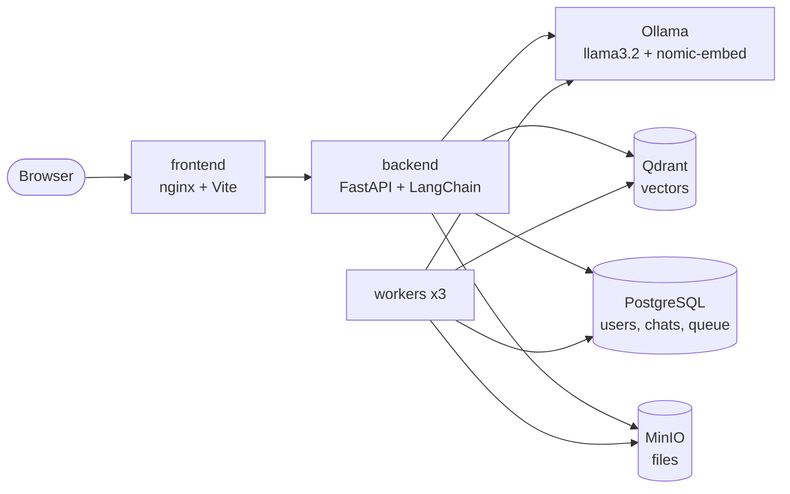

# MyChatApp: a private RAG chatbot

[](https://github.com/prasadvw332-beep/MyChatApp/actions/workflows/ci-cd.yml)

A ChatGPT-style app that answers questions from **your own documents**, with the models running on your
own machine or cluster: nothing is sent to an outside AI service.

Upload PDFs, text or Markdown; ask questions; get streamed answers with clickable sources. Built as a
production-style system: login, a worker pool for bulk loading, Docker and Kubernetes deployment, CI/CD,
and full observability (metrics, traces, token cost).

## Features

| | |
|---|---|
| **Chat with your documents** | answers grounded in the most relevant passages, with source chips that open the page; plain chat when no document matches |
| **Agent mode** | the model chooses tools itself (search, list, read a whole document) over [MCP](docs/agent-mode.md) |
| **Bulk ingestion** | a queue in PostgreSQL and a pool of workers for thousands of documents, with retries ([ingestion](docs/ingestion.md)) |
| **Guardrails** | prompt-injection checks on questions, shared documents and agent tool results; system-prompt leak detection; optional Llama Guard content safety ([guardrails](docs/guardrails.md)) |
| **Accounts** | sign-up/login, per-user chat history, audit log of who did what |
| **Answer quality** | RAGAS evaluation runs from the UI or CLI ([evaluation](docs/evaluation.md)) |
| **Observability** | Grafana dashboard, Prometheus metrics, OpenTelemetry traces, token usage and cost per user ([observability](docs/observability.md)) |
| **Deployable** | Docker Compose for one machine, Kubernetes (dev/prod overlays), GitHub Actions CI/CD ([deploy](deploy/README.md)) |

## How it works



1. **Upload**: the file goes to MinIO; its text is split into section-aware chunks, embedded, and stored in Qdrant.
2. **Ask**: the question is embedded, the closest chunks are retrieved, and the model answers from them,
   streaming token by token. If nothing is relevant enough (`MIN_SCORE`), it answers as a normal chat.

More: [docs/architecture.md](docs/architecture.md) (request flow, layers, every folder).

## Quick start

Needs Docker. From the repository root:

```bash
docker compose -f deploy/docker-compose.yml up -d --build      # or: make up
```

The first start downloads the models (~1.6 GB). Then open:

| | |
|---|---|
| the app | http://localhost:8080 (sign up, upload a document, ask about it) |
| Grafana | http://localhost:3000 |
| Prometheus | http://localhost:9090 |

Kubernetes: `kubectl apply -k deploy/k8s/overlays/dev`, see [deploy/README.md](deploy/README.md).

## Develop

Needs [uv](https://docs.astral.sh/uv/), Node.js 22, and the services (PostgreSQL, Qdrant, MinIO, Ollama)
running, e.g. from the compose file above or as single containers:

```bash
docker run -d --name ollama -p 11434:11434 ollama/ollama
docker exec ollama ollama pull llama3.2:1b && docker exec ollama ollama pull nomic-embed-text
docker run -d --name qdrant -p 6335:6333 qdrant/qdrant
docker run -d --name minio -p 9000:9000 -p 9001:9001 -e MINIO_ROOT_USER=minioadmin \
  -e MINIO_ROOT_PASSWORD=minioadmin123 pgsty/minio server /data --console-address ":9001"
docker run -d --name postgres -p 5432:5432 -e POSTGRES_PASSWORD=postgres -e POSTGRES_DB=mychatapp postgres:17-alpine
```

```bash
cd backend && uv run uvicorn app.main:app --reload --port 8000     # API on :8000
cd frontend && npm install && npm run dev                          # app on :5173
```

Settings are environment variables: [docs/configuration.md](docs/configuration.md).

### Tests and checks

```bash
make check        # everything CI runs: ruff + pytest (backend), eslint + vitest (frontend)
```

Or by hand: `cd backend && uv run --no-dev --group test pytest` and `cd frontend && npm test`. Neither
needs running services: the backends are faked. `make help` lists all tasks (Windows: `winget install ezwinports.make`).

## Tech stack

| Area | Technology |
|---|---|
| Backend | Python 3.14, FastAPI, LangChain, SQLAlchemy + Alembic, Pydantic |
| Models | Ollama: `llama3.2:1b` (chat), `nomic-embed-text` (embeddings) |
| Data | PostgreSQL 17, Qdrant, MinIO (S3-compatible) |
| Agent | Model Context Protocol (MCP) |
| Frontend | Vite, vanilla JavaScript modules, marked + DOMPurify |
| Quality | pytest, Vitest + jsdom, ruff, ESLint, pre-commit, RAGAS |
| Observability | Prometheus, OpenTelemetry, Tempo, Grafana |
| Delivery | Docker, Docker Compose, Kubernetes + Kustomize, GitHub Actions, ghcr.io |

## Documentation

| | |
|---|---|
| [docs/](docs/README.md) | architecture, configuration, production behaviour, observability, ingestion, agent mode, evaluation |
| [docs/decisions/](docs/decisions/README.md) | why it is built this way (decision records) |
| [deploy/README.md](deploy/README.md) | Docker, Kubernetes, CI/CD |
| [CONTRIBUTING.md](CONTRIBUTING.md) | branches, commits, checks, pull requests |
| [CHANGELOG.md](CHANGELOG.md) | what changed and when |
