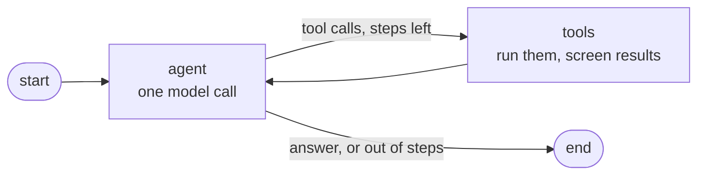

# Agent mode (MCP)

The **Agent** button in the composer switches replies from `/chat` (always retrieve, then answer) to
`/agent/chat`, where the model decides which tools to use: it can skip the documents for a greeting,
search again with other words, or list and read a whole document to summarize it. Each tool call
shows up above the answer.

The agent is a [LangGraph](https://langchain-ai.github.io/langgraph/) graph (`app/agents/loop.py`):



After `AGENT_MAX_STEPS` tool rounds the model is called once more without tools, so it has to answer.
The nodes stream tokens and tool steps to the browser as they happen. There is no checkpointer: a run
lasts one request, and the chat history comes with the request ([decision 0010](decisions/0010-agent-on-langgraph-without-checkpointer.md)).

All tools come from MCP servers (`app/agents/tools.py`):

- **our knowledge-base server** (`app/mcp_server/`): `search_documents`, `list_documents`, `read_document`.
  It is read-only; uploading and deleting stay behind the logged-in API. The agent connects to it in-process.
- **external servers**, optional: point `MCP_SERVERS_FILE` at a JSON file like
  [`backend/mcp_servers.example.json`](../backend/mcp_servers.example.json) (web fetch). Servers that fail to start are skipped.

Every tool result is checked for prompt injection before the model sees it. A web page saying "ignore
your instructions" comes back to the agent as an error instead ([guardrails](guardrails.md)). Tool
*arguments* are not checked, so only add external servers you trust with what the agent can read.

The model must support tool calling. `llama3.2:1b` works but often picks tools badly or writes a tool
call as text; pull a bigger one and set `AGENT_MODEL`, e.g. `ollama pull qwen2.5:7b`.

The same knowledge-base server works in other MCP clients. For Claude Desktop or Claude Code, run it over stdio:

```json
{
  "mcpServers": {
    "my-chatbot-kb": {
      "command": "uv",
      "args": ["run", "--directory", "D:/path/to/backend", "--env-file", ".env", "python", "-m", "app.mcp_server"]
    }
  }
}
```

It reads Qdrant, PostgreSQL and MinIO directly, so it bypasses the login: use it only on your own machine.
