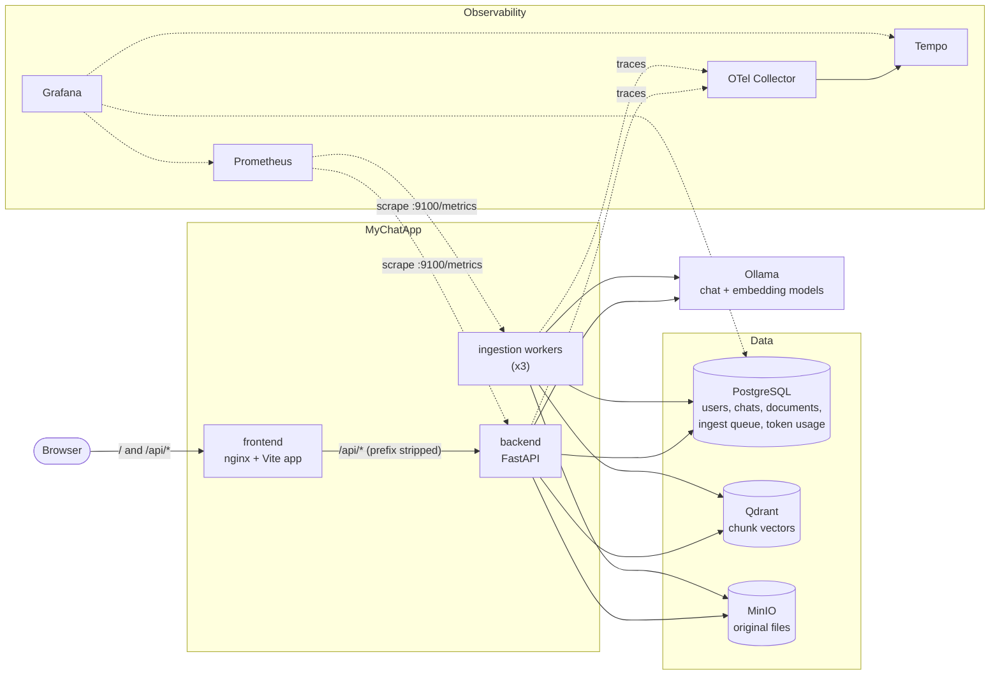
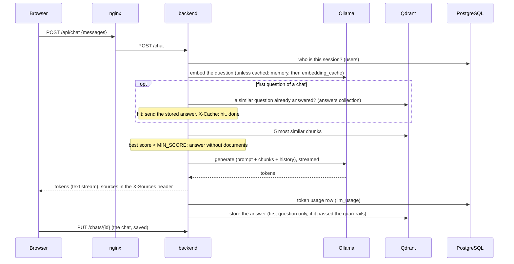
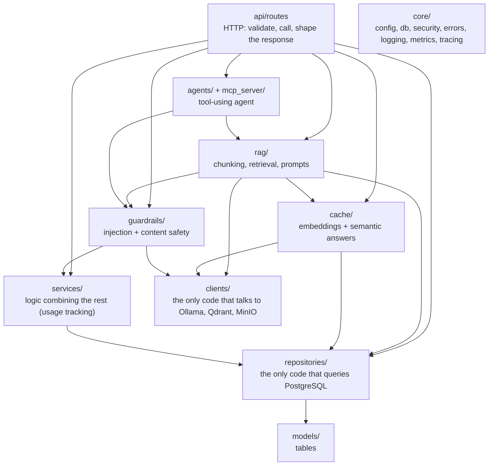

# Architecture

## The system



- **frontend**: nginx serves the built site and forwards `/api/*` to the backend, so the browser
  talks to one origin (no CORS in production). See [frontend/nginx.conf.template](../frontend/nginx.conf.template).
- **backend**: the HTTP API. Every route except `/health*` and `/auth/*` needs a login (session cookie).
- **workers**: the same image as the backend with another command; they take documents from a queue in
  PostgreSQL and index them ([ingestion.md](ingestion.md)).
- **Ollama**: runs the models locally. Swapping it for a hosted model is a change in `backend/app/clients/llm.py`.

## A chat request



See [caching.md](caching.md) for both caches.

Agent mode (`POST /agent/chat`) replaces the fixed "retrieve, then answer" with a loop where the model
chooses tools; see [agent-mode.md](agent-mode.md).

## Layers in the backend



Arrows point at what a layer may use. Two rules keep it changeable:
- **Only `repositories/` queries tables, only `clients/` calls external servers.** Moving from Qdrant to
  another vector database, or from Ollama to a hosted API, touches one module.
- **Routes stay thin.** They validate input (Pydantic models in `schemas/`) and call the layers below;
  the logic lives where it can be tested without HTTP.

## Folder by folder

```
backend/                    Python API + ingestion workers (one Docker image)
  app/
    main.py                 creates the FastAPI app: middleware, startup, mounts api_router
    core/                   cross-cutting plumbing, used by everything
      config.py             settings from environment variables (docs/configuration.md)
      db.py                 SQLAlchemy engine/session, runs migrations at startup
      security.py           password hashing, session tokens, login throttling
      errors.py             AppError types + handlers: one JSON error shape, no internals leaked
      logging.py            JSON logs in production; request id, user id and trace id on every line
      middleware.py         request id (X-Request-ID), access log, HTTP metrics, last-resort 500
      audit.py              audit events: who did what (login, upload, delete, ...)
      metrics.py            every Prometheus metric, served on :9100
      telemetry.py          OpenTelemetry tracing (off unless OTEL_EXPORTER_OTLP_ENDPOINT is set)
    models/                 database tables, one file per area
    schemas/                request/response bodies (Pydantic), one file per API area
    api/                    HTTP layer
      router.py             all routes in one place; which are public / need a login
      deps.py               shared dependencies (CurrentUser)
      routes/               health, auth, chat, agent, chats, documents, ingest, evals
    prompts/                prompt templates, one file per feature
    rag/                    chunking.py, knowledge_base.py (index/retrieve/delete), answer.py
    cache/                  embeddings.py (memory + PostgreSQL), semantic.py (answers) (docs/caching.md)
    agents/                 loop.py (LangGraph: model -> tools -> ... -> answer), tools.py (over MCP)
    mcp_server/             the knowledge base as an MCP server (search, list, read documents)
    ingestion/              queue.py (in PostgreSQL), worker.py, cli.py
    clients/                llm.py (Ollama), storage.py (MinIO), vector_store.py + answer_store.py (Qdrant)
    repositories/           chat_store, doc_store, user_store, usage_store, embedding_cache_store
    services/               usage.py: token + cost tracking
    guardrails/             injection.py (patterns, fencing, canary), content.py (Llama Guard) (docs/guardrails.md)
  migrations/               Alembic database migrations
  evals/                    RAGAS evaluation dataset and runner (docs/evaluation.md)
  tests/                    no services needed: fakes.py replaces Qdrant/MinIO/Ollama/PostgreSQL
    unit/                   code called directly
    api/                    the HTTP contract, through FastAPI's TestClient
frontend/                   Vite + vanilla JS, built into an nginx image
  src/
    main.js                 entry point: wires the features together, waits for a login
    api.js                  every backend call in one place
    state.js                shared app state (chats, open chat, streaming reply, agent mode)
    features/               one module per part of the screen: auth, chats, messages, composer,
                            documents, sidebar, theme, evals
    ui/                     icons, small widgets
  tests/                    Vitest in jsdom: helpers + a smoke test of the whole app
deploy/
  docker-compose.yml        everything on one machine
  k8s/base/                 Kubernetes manifests, the same in every environment
  k8s/overlays/dev|prod/    what differs per environment
  observability/            Prometheus, Grafana (+ dashboard generator), Tempo, OTel Collector
docs/                       this documentation; decisions/ = why things are the way they are
.github/workflows/          CI/CD: lint, test, build images, push to ghcr.io, deploy
```

## Where new things go

| Adding... | Put it in |
|---|---|
| an endpoint | `api/routes/<area>.py`, then one line in `api/router.py` |
| a request/response body | `schemas/<area>.py` |
| a table | `models/<area>.py`, export it in `models/__init__.py`, then an Alembic migration |
| a query on a table | the table's module in `repositories/` (routes never query tables directly) |
| an external system (Redis, S3, an API) | a client in `clients/` |
| logic combining clients, repositories and metrics | `services/` |
| a setting | `core/config.py` + `.env.example` + `deploy/k8s/base/configmap.yaml` + [configuration.md](configuration.md) |
| a prompt | `prompts/<feature>.py` |
| an agent tool | a tool on an MCP server: ours in `mcp_server/`, or an external one in `MCP_SERVERS_FILE` |
| a metric | `core/metrics.py`, then a panel in `deploy/observability/grafana/build_dashboard.py` |
| a background job | like `ingestion/`: its own package with a worker entry point |
| a part of the screen | `frontend/src/features/<name>.js`, initialised from `main.js`; backend calls in `api.js` |
| a test | backend `tests/unit/` or `tests/api/`; frontend `frontend/tests/` |
| a decision others should know about | a new record in [decisions/](decisions/) |
