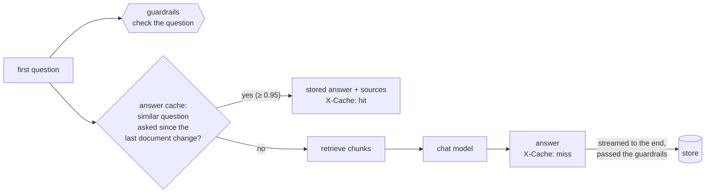

# Caching

Two caches cut the work the models do. Both are on by default, and both are best-effort: if one fails,
the request goes ahead without it and `cache_errors_total` counts the failure.

| | Embedding cache | Semantic answer cache |
|---|---|---|
| Saves | one call to the embedding model | retrieval **and** the chat model: the whole answer |
| Key | the exact text (sha256 of model + text) | the *meaning* of the question (cosine similarity ≥ 0.95) |
| Where | an LRU in each process, then PostgreSQL (`embedding_cache`) | Qdrant collection `<QDRANT_COLLECTION>_answers` |
| Can it be wrong? | no: the same text always gets the same vector | yes, if two different questions look alike. Hence the strict threshold |
| Emptied | never needed; safe to `TRUNCATE` at any time | on every document upload, re-index and delete; entries expire after 24 h |
| Code | [cache/embeddings.py](../backend/app/cache/embeddings.py) | [cache/semantic.py](../backend/app/cache/semantic.py), [clients/answer_store.py](../backend/app/clients/answer_store.py) |

Measured on the Docker Compose stack, on a CPU:

| | Without cache | With cache |
|---|---|---|
| Embedding a question | 3–14 s on the first call (includes loading the model) | 0.05–0.1 ms from memory, 3–6 ms from PostgreSQL |
| `POST /chat`, the same first question again | 1–74 s (depends on the answer's length and whether the model is loaded) | 0.03–0.25 s |

## Embedding cache

Every text sent to the embedding model goes through `CachedEmbeddings`: chat questions, the agent's
searches and the chunks of every indexed document.

1. **Memory** (`EMBED_CACHE_MEMORY_ITEMS`, default 10 000 vectors ≈ 63 MB per process). A chat request
   embeds its question twice, once to look up the answer cache and once to search the documents; the
   second time is free.
2. **PostgreSQL**, shared by the backend replicas and the ingestion workers, kept across restarts.
   Re-indexing a document only embeds the chunks whose text changed: a worker retrying a document that
   failed half-way, or an edited file uploaded again.

The key is the text the model really sees, task prefix included (`search_query: ...` vs
`search_document: ...`), plus the model name, so a query never reuses a document's vector, and changing
`EMBED_MODEL` starts from an empty cache. Rows are about 3 KB each. Old rows are never used again after
a model change; delete them with `DELETE FROM embedding_cache WHERE model <> 'nomic-embed-text'`.

## Semantic answer cache

**What is cached.** Only a chat's **first** question. A follow-up such as "and his email?" means
something different in every conversation, so it is never stored or looked up (`X-Cache: off`). An answer
is stored only if it streamed to the end and passed the output guardrails, never an error or a withheld
answer. The question guardrails still run on a cache hit, because the question is new even when the
answer is not.

**Shared by all users**, like the documents the answers come from. There is nothing per-user in a
first question's answer: the prompt is the documents and the question.

**Staying correct when documents change.** An answer is only as current as the documents it was written
from, so `knowledge_base.ingest`, `index` (the workers) and `delete_document` all empty the cache. A clear
writes a `cleared_at` time, and a lookup only accepts answers to questions *asked* after it. This covers
the race where a chat reads the documents, a file is uploaded while the model is still writing, and the
outdated answer is stored after the clear: it is stored, but never served. If the clear itself fails
(Qdrant down), it is logged as an error and counted, and old answers stay servable until they expire
(`SEMANTIC_CACHE_TTL_SECONDS`).

Changing `CHAT_MODEL` also starts from an empty cache (answers are filtered by model).

### Choosing the threshold

Cosine similarity of `nomic-embed-text` question vectors, against "What is the candidate's phone number?":

| Score | Question | |
|---|---|---|
| 0.997 | what's the candidate's phone number | same question |
| 0.994 | What is the phone number of the candidate? | same question |
| 0.975 | candidate phone number? | same question |
| 0.926 | Tell me the candidate's phone number | same question, **missed** at 0.95 |
| 0.865 | What is the candidate's email address? | different question |
| 0.859 | What is the candidate's phone model? | different question |
| 0.827 | What is the candidate's home address? | different question |
| 0.724 | Which university did the candidate attend? | different question |

Different questions score as high as 0.87 because they share most of their words. 0.95 stays well clear of
them and still catches rewordings. A miss only costs a normal answer, while a false hit gives the wrong one,
so err on the high side. Before lowering it, run your users' real questions through the same comparison.

## Turning them off

`EMBED_CACHE=false` and `SEMANTIC_CACHE=false` ([configuration.md](configuration.md#caching)). Delete the
answers collection after turning the semantic cache back on if documents changed in between, since nothing
emptied it while it was off.

## Monitoring

The Grafana row **Caching** shows the share of first questions answered from the cache, embeddings by
source (memory, PostgreSQL, model) and cache errors. Metrics: `semantic_cache_lookups_total{result}`,
`embedding_cache_lookups_total{result}`, `cache_errors_total{cache}`.

## Not cached

- **Agent mode** (`/agent/chat`): its answer depends on which tools it chose and what external MCP servers
  returned at that moment. Its document searches do use the embedding cache.
- **Chat titles**: cheap (20 tokens), and generated from several questions at once.
